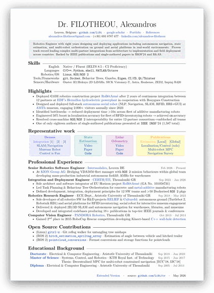
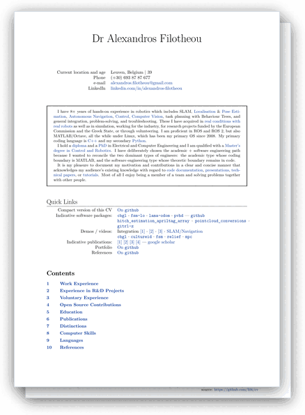
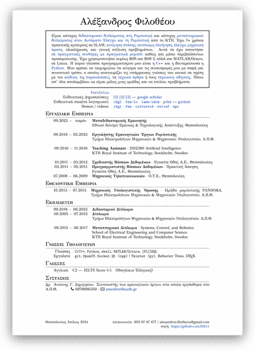
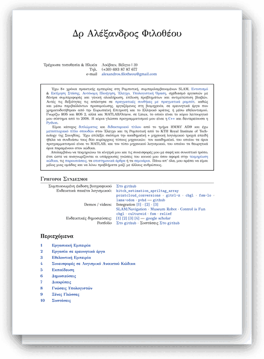

Table of Contents
=================
<!--
* English:            [`Calling-card`](https://docs.google.com/viewerng/viewer?url=https://raw.githubusercontent.com/li9i/CV/master/calling-card/cv_card_alexandros_filotheou.pdf) < [`Compact`](https://docs.google.com/viewerng/viewer?url=https://raw.githubusercontent.com/li9i/CV/master/compact/cv_compact_alexandros_filotheou.pdf) < [`Extended`](https://docs.google.com/viewerng/viewer?url=https://raw.githubusercontent.com/li9i/CV/master/extended/cv_extended_alexandros_filotheou.pdf)
* Ελληνικά: [`Μονοσέλιδο`](https://docs.google.com/viewerng/viewer?url=https://raw.githubusercontent.com/li9i/CV/master/%CF%83%CF%8D%CE%BD%CF%84%CE%BF%CE%BC%CE%BF/cv_compact_alexandros_filotheou.pdf) < [`Αναλυτικό`](https://docs.google.com/viewerng/viewer?url=https://raw.githubusercontent.com/li9i/CV/master/%CE%B1%CE%BD%CE%B1%CE%BB%CF%85%CF%84%CE%B9%CE%BA%CF%8C/cv_extended_alexandros_filotheou.pdf)
-->

<table>
  <tr>
    <td align="center" width="33%">
      <a href="https://docs.google.com/viewerng/viewer?url=https://raw.githubusercontent.com/li9i/CV/master/calling-card/cv_card_alexandros_filotheou.pdf">
        
      </a><br>
      <b>Calling-card</b><br>
      <sub>English &middot; 1 page</sub>
    </td>
    <td align="center" width="33%">
      <a href="https://docs.google.com/viewerng/viewer?url=https://raw.githubusercontent.com/li9i/CV/master/compact/cv_compact_alexandros_filotheou.pdf">
        
      </a><br>
      <b>Compact</b><br>
      <sub>English &middot; 1 page</sub>
    </td>
    <td align="center" width="33%">
      <a href="https://docs.google.com/viewerng/viewer?url=https://raw.githubusercontent.com/li9i/CV/master/extended/cv_extended_alexandros_filotheou.pdf">
        
      </a><br>
      <b>Extended</b><br>
      <sub>English &middot; 8 pages</sub>
    </td>
  </tr>
  <tr>
    <td width="33%"></td>
    <td align="center" width="33%">
      <a href="https://docs.google.com/viewerng/viewer?url=https://raw.githubusercontent.com/li9i/CV/master/%CF%83%CF%8D%CE%BD%CF%84%CE%BF%CE%BC%CE%BF/cv_compact_alexandros_filotheou.pdf">
        
      </a><br>
      <b>Μονοσέλιδο</b><br>
      <sub>Ελληνικά &middot; 1 σελίδα</sub>
    </td>
    <td align="center" width="33%">
      <a href="https://docs.google.com/viewerng/viewer?url=https://raw.githubusercontent.com/li9i/CV/master/%CE%B1%CE%BD%CE%B1%CE%BB%CF%85%CF%84%CE%B9%CE%BA%CF%8C/cv_extended_alexandros_filotheou.pdf">
        
      </a><br>
      <b>Αναλυτικό</b><br>
      <sub>Ελληνικά &middot; 8 σελίδες</sub>
    </td>
  </tr>
</table>

<!--
The thumbnails above are generated from the PDFs themselves. A thicker stack means a
longer document. Rebuild them after any PDF changes with:

```
make thumbs
```

This needs `poppler-utils` and `imagemagick`.
-->
